# OpenDID 설치 가이드 — Orchestrator — v3.0.0.0

## 1. OpenDID 소개

이 문서는 Orchestrator를 사용해 OpenDID 3.0 통합 환경을 구성하는 방법을 설명합니다. 통합 릴리스 버전은 3.0.0.0, 개별 서버 빌드 버전은 3.0.0입니다. Orchestrator는 TA, Issuer, Verifier, API Gateway, CA, Wallet, Proxy, Demo와 선택한 원장 백엔드를 관리합니다.

Proxy는 OpenDID VC 발급·폐기 시 Holder 앱과 Issuer 사이에서 TA 대신 중계하는 서비스입니다. 엔티티가 아니므로 지갑·DID 등록 단계가 없습니다. OID4VCI는 Issuer가 제공하는 별도의 발급 경로입니다.

## 2. 설치 개요

1. Java, Node.js, Git, Docker와 디스크 공간을 준비합니다.
2. Orchestrator 소스를 받고 각 3.0.0 서버 JAR를 빌드하거나 준비합니다.
3. 원장 백엔드와 DB를 설정하고 Orchestrator를 시작합니다.
4. 실제 엔티티를 등록하고 서비스를 시작한 뒤 Issuer·Verifier를 설정합니다.
5. OpenDID 및 OID4VCI 통합 테스트를 실행합니다.

## 3. 시스템 요구사항

[시스템 요구사항](./OpenDID_System_Requirements_ko.md)을 확인하세요. 기본 포트 9001, 8090–8095, 8097–8099, 5430의 사용 가능 여부를 확인하거나 Orchestrator 설정을 수정합니다. 서버 빌드는 Java 21을 사용하며 Gradle은 각 저장소의 wrapper를 사용합니다.

## 4. 사전 준비

Git, Java 21, Node.js 22.12.0, Docker를 설치합니다. 현재 개발 환경에서는 사용 가능한 서버 저장소의 `feature/opendid3.0` 브랜치를 사용합니다. Proxy와 Orchestrator의 3.0 변경은 현재 `develop` 소스에 있습니다. DB, 구성 파일, 인증 정보 준비 사항은 각 서버 설치 가이드를 따릅니다.

## 5. 설치 및 등록

### 5.1. Orchestrator 소스와 서버 아티팩트

```bash
git clone https://github.com/OmniOneID/did-orchestrator-server.git
cd did-orchestrator-server/source/did-orchestrator-server
./gradlew build
```

`download.sh`는 GitHub Releases의 `V3.0.0` 태그에서 서버 JAR를 내려받습니다. 해당 아티팩트가 게시된 **후에만** `bash download.sh 3.0.0`을 사용하세요. 현재 3.0 통합 테스트에서는 각 서버를 소스에서 빌드하고 `*-3.0.0.jar`를 `jars/API`, `jars/CA`, `jars/Demo`, `jars/Issuer`, `jars/LSS`, `jars/Proxy`, `jars/TA`, `jars/Verifier`, `jars/Wallet`의 해당 디렉터리에 배치합니다. 파일명은 `configs/application.yml`과 일치해야 합니다. 로컬 지갑·DID·비밀번호·DB 파일은 소스 관리에 포함하지 마세요.

### 5.2. PostgreSQL과 원장 백엔드

Orchestrator 화면이나 제공된 Docker 스크립트로 PostgreSQL을 시작합니다. Orchestrator 화면에서 Hyperledger Besu 또는 Ledger Service를 선택하고 엔티티 등록 전에 선택한 백엔드를 설정합니다. `configs/application.yml`의 기본 포트는 PostgreSQL 5430, Ledger Service 8098입니다.

### 5.3. Orchestrator 시작

빌드한 Orchestrator JAR 또는 Gradle `bootRun`으로 서버를 시작하고 `http://localhost:9001`에 접속합니다. 설정에 3.0.0 JAR 파일명과 Proxy 포트 8097이 보이는지 확인합니다. UI 사용법은 [Orchestrator 설명서](https://github.com/OmniOneID/did-orchestrator-server/blob/develop/docs/manual/orchestrator_manual_ko.md)를 참고하세요.

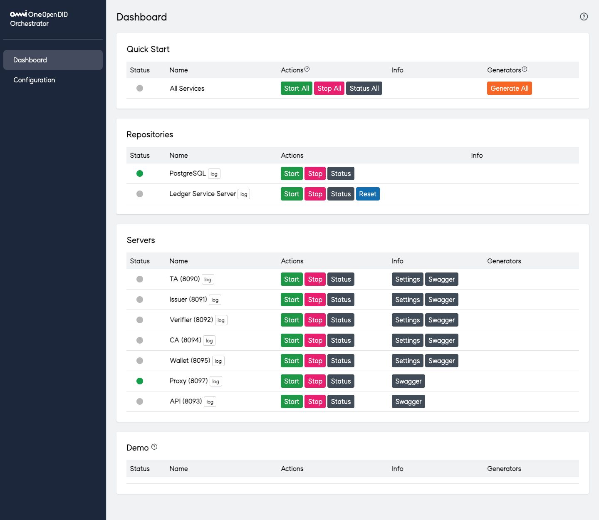

### 5.4. 엔티티 등록과 서비스 시작

필요한 엔티티에만 지갑과 DID Document를 생성합니다. Proxy는 엔티티 생성이나 `/entities` 응답에 포함되면 안 됩니다. 서버별 가이드에 따라 TA, Issuer, Verifier, CA, Wallet을 등록하고 API Gateway와 Demo를 시작합니다. Proxy는 일반 서비스로 시작하고 상태·로그를 확인합니다. Proxy에서 Issuer에 연결되는지도 확인합니다.

## 6. 어드민 설정

V2와 동일하게 TA → Issuer → Verifier 순서로 설정합니다. 각 Admin Console의 첫 로그인 변경과 엔티티 등록을 마쳐야 기능 메뉴가 표시됩니다. 기존 OpenDID KYC·VC Schema·Issue Profile·VP 정책의 세부 설정은 서버별 Admin 가이드를 따릅니다. 이 절은 3.0에서 추가된 OID4VCI·OID4VP 화면 항목과 설정 순서를 설명합니다.

화면 예시는 3.0 서버의 Admin 가이드에서 가져왔습니다. 실제 캡처는 2026-11-10에 신규 로컬 DB에서 촬영했으며 이미지 폭은 1290픽셀입니다. TA·Issuer·Verifier 등록과 아래 관리 설정은 완료했지만, 실제 Credential 발급과 Presentation 제출은 별도 검증이 필요합니다.

### 6.1. TA Admin — 신뢰 목록

#### 6.1.1. OID4VCI Credential Issuers

이 목록은 OID4VCI 발급자를 신뢰 목록에 넣기 위한 승인 화면입니다. Issuer가 List Provider 등록을 요청하면 TA에 `REQUESTED` 항목이 생깁니다. TA 관리자는 Issuer Metadata URI와 발급 시작 URI를 확인한 뒤 `ACTIVE`로 승인합니다. TA 화면에서는 요청을 새로 등록하지 않습니다.

| 화면 항목 | 설명 |
| --- | --- |
| Credential Issuer | 등록을 요청한 발급자 식별자입니다. 캡처 환경에서는 `did:omn:issuer`입니다. |
| Credential Issuer Metadata URI | Wallet과 List Provider가 발급자 정보를 조회할 주소입니다. |
| User Initiation URI | 사용자가 발급 절차를 시작할 주소입니다. |
| Current Status / Status History | 현재 승인 상태와 변경 이력을 확인합니다. |

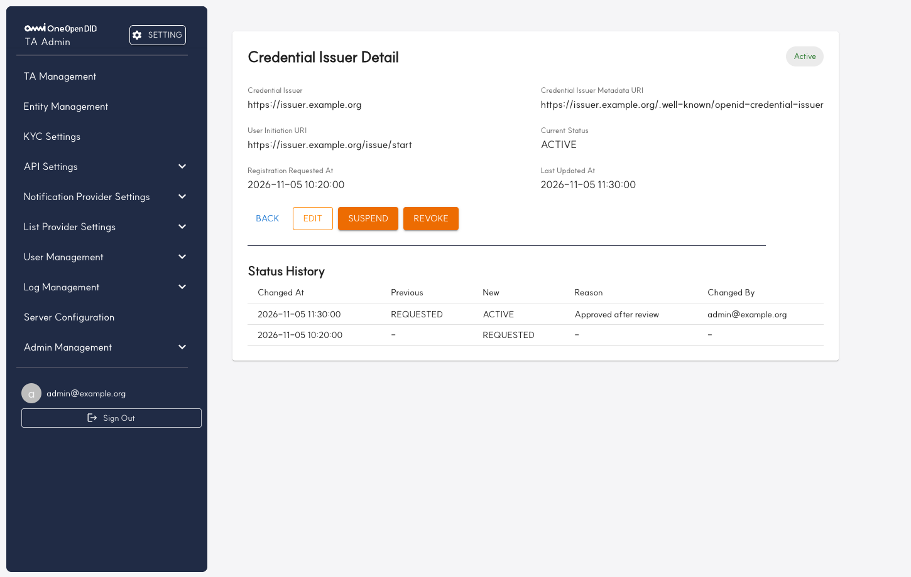

- OID4VCI 발급자 상세 예시입니다. 요청 상태와 변경 이력을 확인하는 위치를 보여 줍니다.

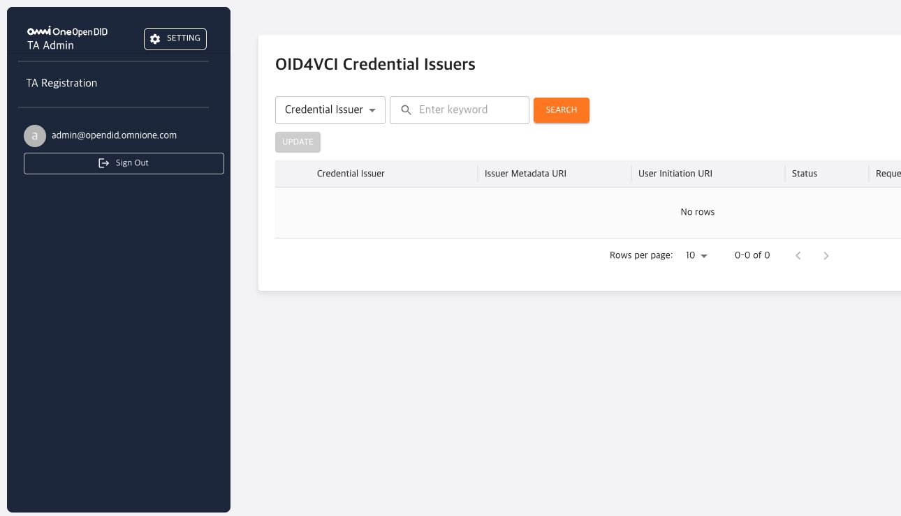

- Issuer 요청 전의 목록입니다. 등록된 발급자가 없어 행이 비어 있습니다.

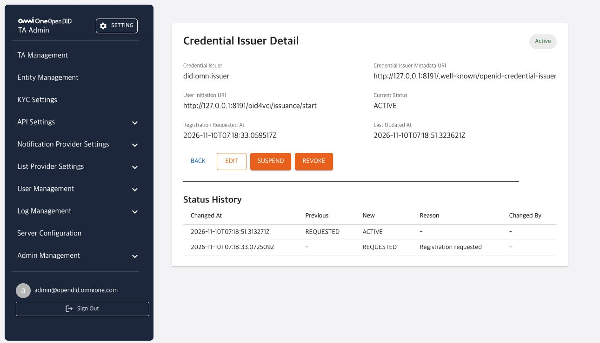

- TA가 Issuer 요청을 승인한 결과입니다. 현재 상태와 변경 이력이 ACTIVE로 표시됩니다.

#### 6.1.2. mDoc Trusted Issuers

mdoc 검증에 사용할 신뢰 발급자와 허용할 문서 유형을 등록합니다. 등록이 완료된 Issuer를 선택하고 Metadata에서 docType을 불러온 뒤 필요한 유형만 선택합니다. 캡처 환경에서는 `org.omnione.opendid.doc`을 허용했습니다.

| 화면 항목 | 설명 |
| --- | --- |
| Issuer / DID | 신뢰할 Issuer 엔티티와 DID입니다. |
| Issuer metadata URL / Load docTypes | Metadata URL에서 발급자가 선언한 mdoc 유형을 읽습니다. |
| docTypes / Current Status | 검증에 허용한 문서 유형과 등록 상태입니다. |

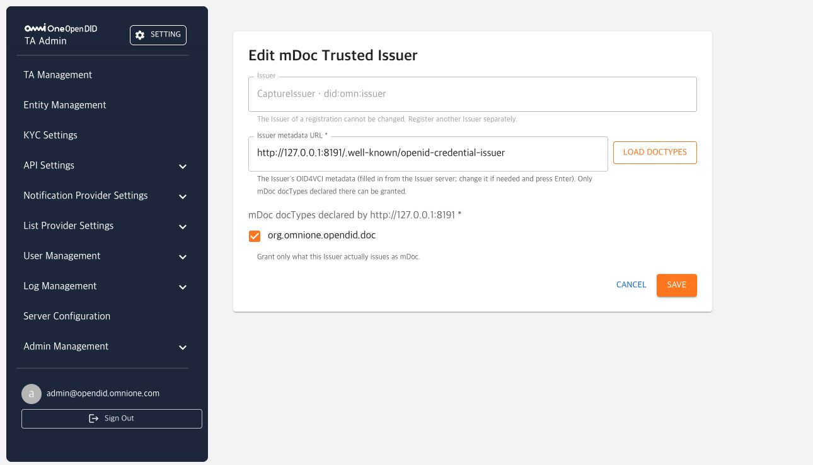

- 등록된 Issuer의 Metadata에서 `org.omnione.opendid.doc`을 불러와 허용한 화면입니다.

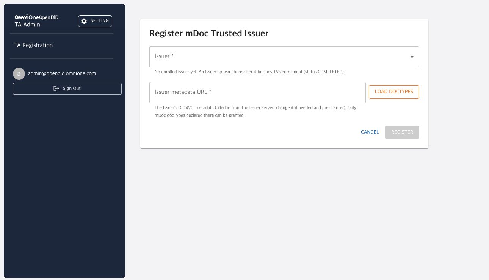

- mdoc 신뢰 발급자 등록 전 화면입니다. Issuer와 docType을 지정하는 폼입니다.

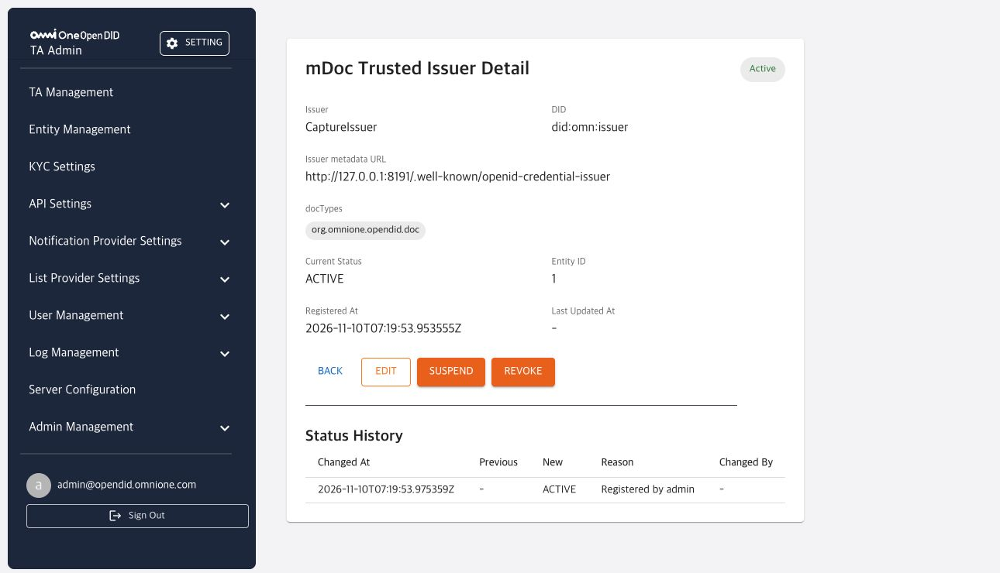

- 등록된 mdoc 신뢰 발급자 상세입니다. 허용한 docType과 ACTIVE 상태를 확인합니다.

### 6.2. Issuer Admin — OID4VCI 발급

Issuer 엔티티 등록 후 Metadata → Credential Configurations → Client Settings → List Provider 순서로 확인합니다. 실제 VC 발급에 필요한 Schema와 Issue Profile은 [Issuer Admin 가이드](https://github.com/OmniOneID/did-issuer-server/blob/feature/opendid3.0/docs/admin/OpenDID_IssuerAdmin_Operation_Guide_ko.md)를 따릅니다.

#### 6.2.1. Issuer Metadata

Wallet에 공개할 발급자 주소와 발급 Endpoint를 설정합니다. Credential Issuer 기준 URL을 바꾸면 공개 Metadata의 Endpoint도 영향을 받으므로, Wallet에서 접근 가능한 주소인지 확인합니다.

| 화면 항목 | 설명 |
| --- | --- |
| Credential Issuer / Authorization Servers | 발급자 기준 URL과 인증·인가를 처리할 서버 URL입니다. |
| Credential Offer / Credential / Nonce Endpoint | 발급 제안, Credential 요청, 일회용 `c_nonce` 요청 주소입니다. |
| Revocation / Deferred / Notification Endpoint | 폐기, 지연 발급, 결과 알림 주소입니다. 폐기는 OpenDID 확장입니다. |
| Request / Response Encryption | 발급 요청·응답 암호화 지원 방식과 필수 여부입니다. |

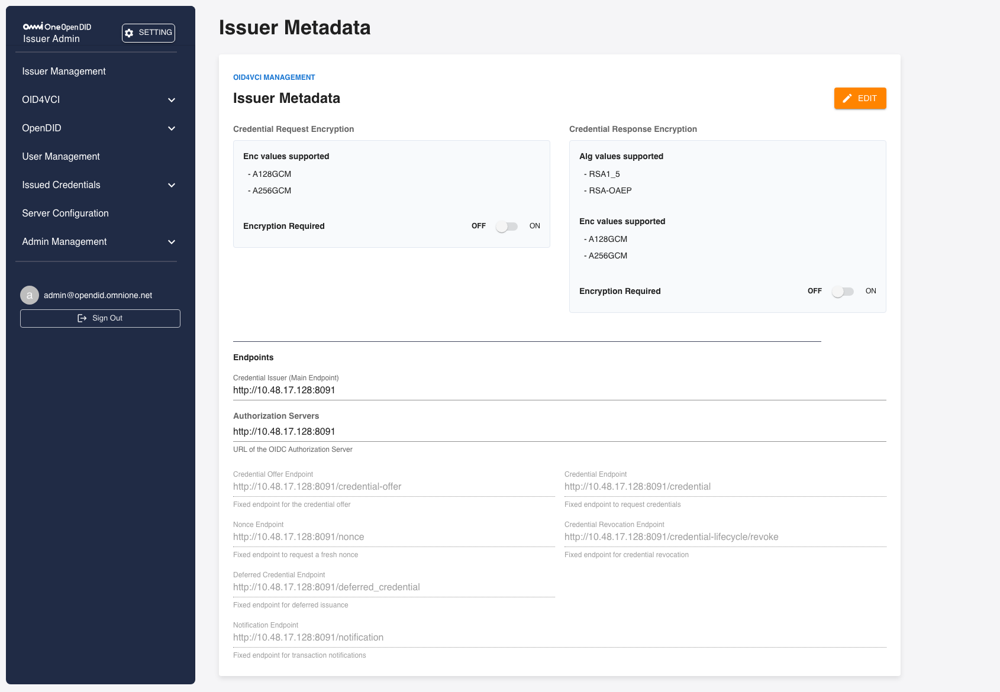

- Issuer Metadata 설정 예시입니다. 발급자 주소와 공개 Endpoint를 확인합니다.

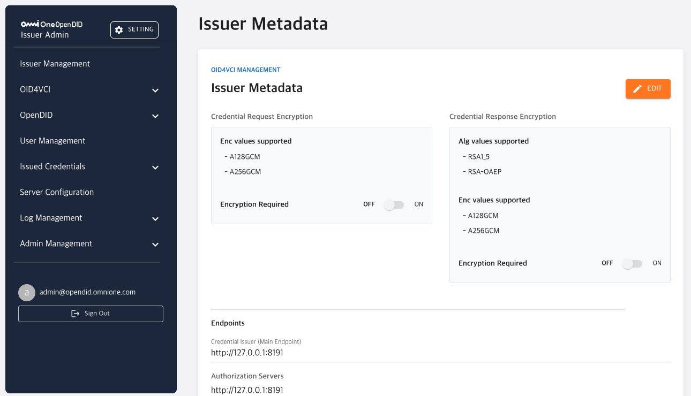

- 실제 Metadata 상단입니다. 캡처용 Issuer의 공개 주소와 기본 설정을 확인합니다.

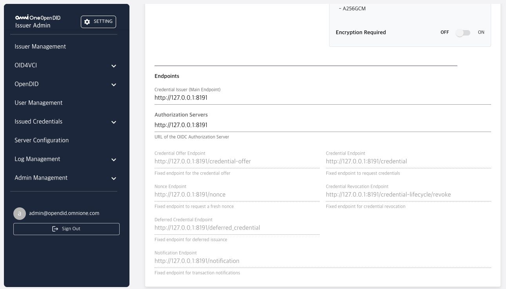

- 같은 화면의 하단입니다. Credential·Nonce 등 Endpoint가 8191을 가리킵니다.

#### 6.2.2. Credential Configurations

발급할 Credential의 형식과 Wallet에 노출할 Metadata를 등록합니다. 캡처 환경에서는 `CaptureMdocPID`를 `mso_mdoc-did` 형식과 `org.omnione.opendid.doc` doctype으로 저장했습니다. 등록한 Configuration은 공개 Issuer Metadata의 `credential_configurations_supported`에 조회 시 반영됩니다.

| 화면 항목 | 설명 |
| --- | --- |
| Configuration ID / Format | 발급 구성을 식별하는 값과 Credential 형식입니다. |
| Identifiers (SDK) | SDK가 Credential을 식별하는 값입니다. 캡처 예시는 `mDocPID`입니다. |
| Document type (doctype) / Display name | mdoc의 실제 문서 유형과 Wallet에 표시할 이름입니다. |
| Scope / Cryptographic binding methods | Scope로 요청할 때의 값과 키 바인딩 방식입니다. |
| Claims | Claim 경로, 표시 이름, 필수 여부, 값 형식을 정의합니다. |

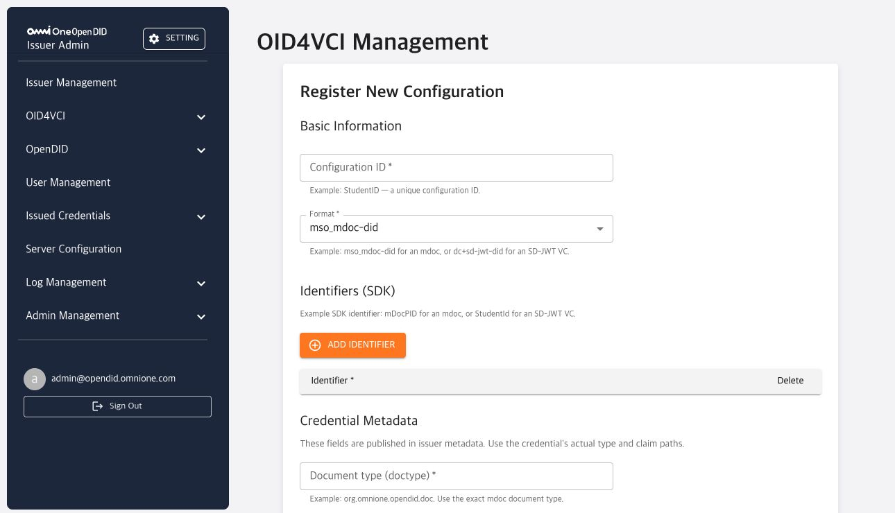

- 저장 전 등록 폼 상단입니다. Configuration ID, 형식, SDK Identifier를 입력합니다.

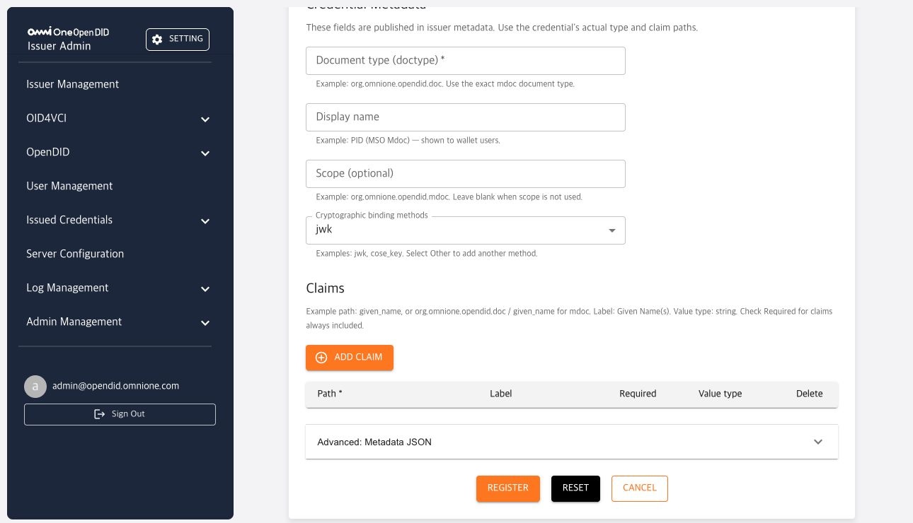

- 같은 폼의 하단입니다. docType, 표시 이름, Claim을 설정하는 영역입니다.

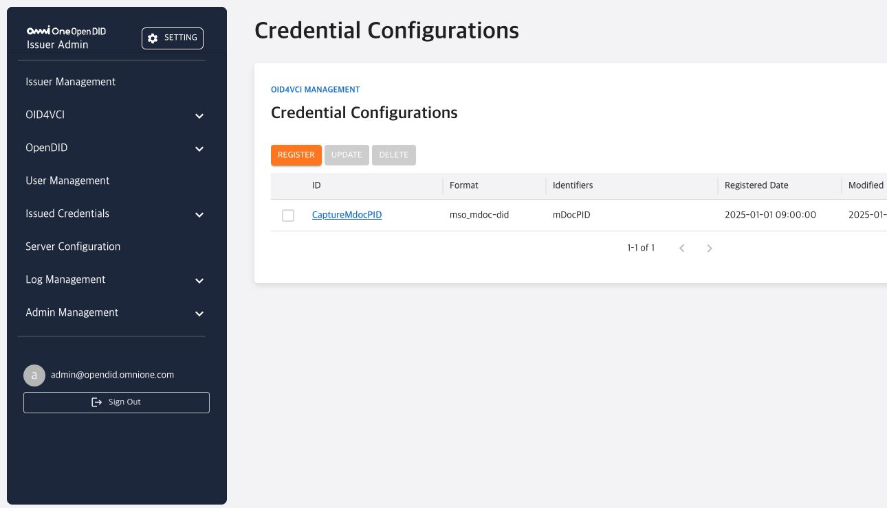

- 저장된 Credential Configuration 목록입니다. CaptureMdocPID와 mdoc 형식을 확인합니다.

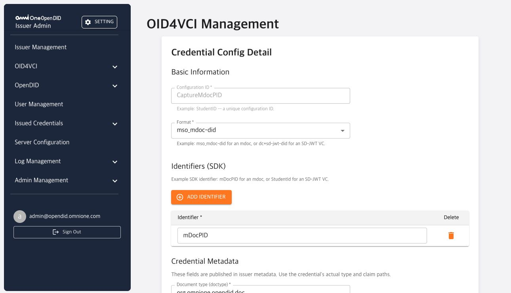

- 저장된 설정 상세 상단입니다. CaptureMdocPID, mso_mdoc-did, mDocPID가 표시됩니다.

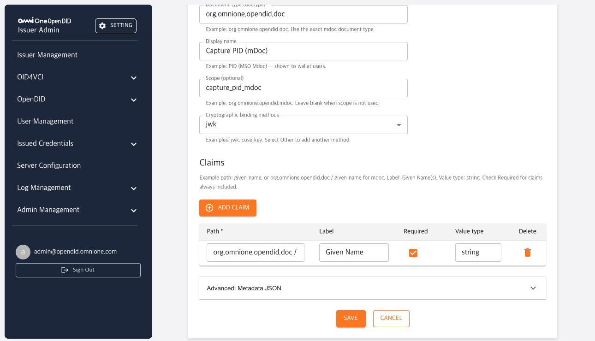

- 저장된 설정 상세 하단입니다. `org.omnione.opendid.doc`과 given_name Claim을 확인합니다.

#### 6.2.3. Client Settings

OID4VCI 인가에 사용할 공통 및 플랫폼별 Client 값을 확인합니다. Redirect URI는 인가가 끝난 뒤 앱으로 돌아갈 주소이며, 실제 앱에 등록된 값과 일치해야 합니다. 캡처는 현재 설정값을 보여 주며 새 Client를 생성한 결과는 아닙니다.

| 화면 항목 | 설명 |
| --- | --- |
| Main Client Settings | 공통 Client ID, Secret, Redirect URI, Scope입니다. |
| Android / iOS Client | 각 모바일 앱에서 사용할 Client ID와 Redirect URI입니다. |
| Android / iOS OpenID Client | OpenID 방식 앱에서 사용할 별도 Client 설정입니다. |

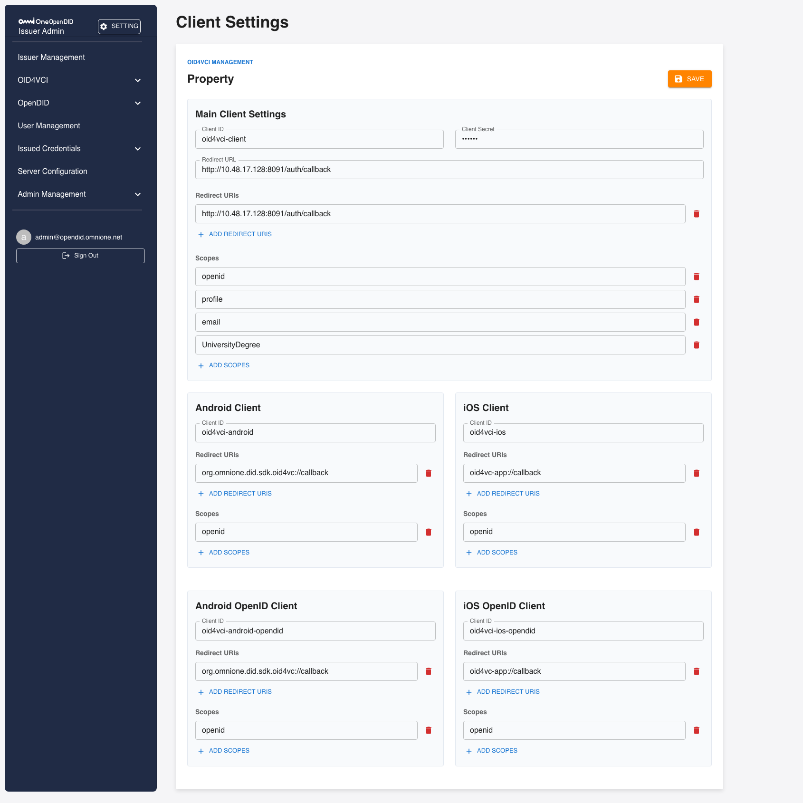

- 클라이언트 설정 예시입니다. 앱별 Client ID와 Redirect URI를 확인합니다.

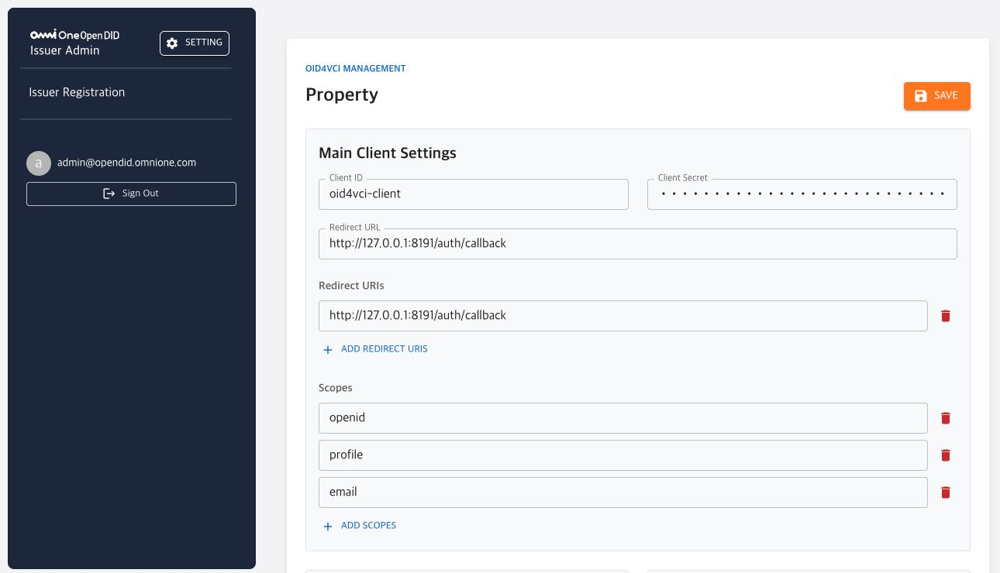

- 클라이언트 설정 상단입니다. OID4VCI 인가와 Client 기본값을 확인합니다.

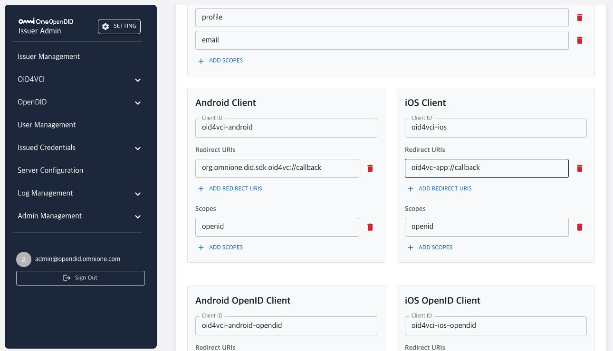

- 클라이언트 설정 중단입니다. Android·iOS 앱의 Client ID와 Redirect URI를 보여 줍니다.

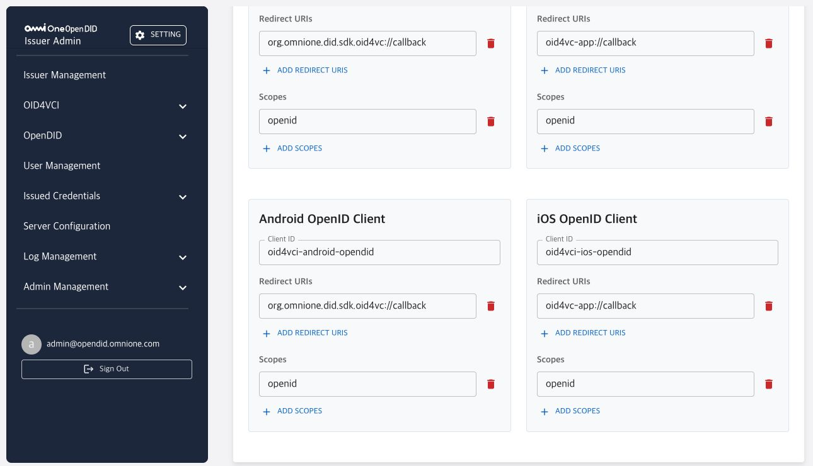

- 클라이언트 설정 하단입니다. OpenDID용 Android·iOS Client 값을 보여 줍니다.

#### 6.2.4. List Provider

사용자 주도 Webview 발급에 사용할 Issuer 정보를 TA의 List Provider에 요청합니다. 캡처 환경에서는 기본 TA 주소 8090을 캡처용 8190으로 바꾸어 요청했습니다. 이 Issuer 화면의 `REQUESTED`는 요청 당시 저장된 상태이며, TA 승인 후의 현재 상태는 TA Admin의 OID4VCI Credential Issuers 상세에서 확인합니다.

| 화면 항목 | 설명 |
| --- | --- |
| List Provider URL | 등록 요청을 보낼 TA List Provider 주소입니다. |
| Credential Issuer | Issuer DID에서 불러온 발급자 식별자입니다. |
| Credential Issuer Metadata URI / User Initiation URI | 발급자 정보 조회 주소와 발급 시작 주소입니다. |
| Registration Status / Refresh | Issuer에 저장된 요청 시점의 상태와 등록 정보 재조회 기능입니다. |

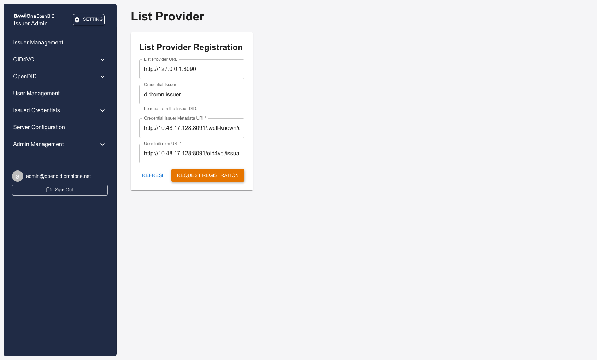

- List Provider 등록 예시입니다. TA 주소와 Issuer Metadata URI를 확인한 뒤 요청합니다.

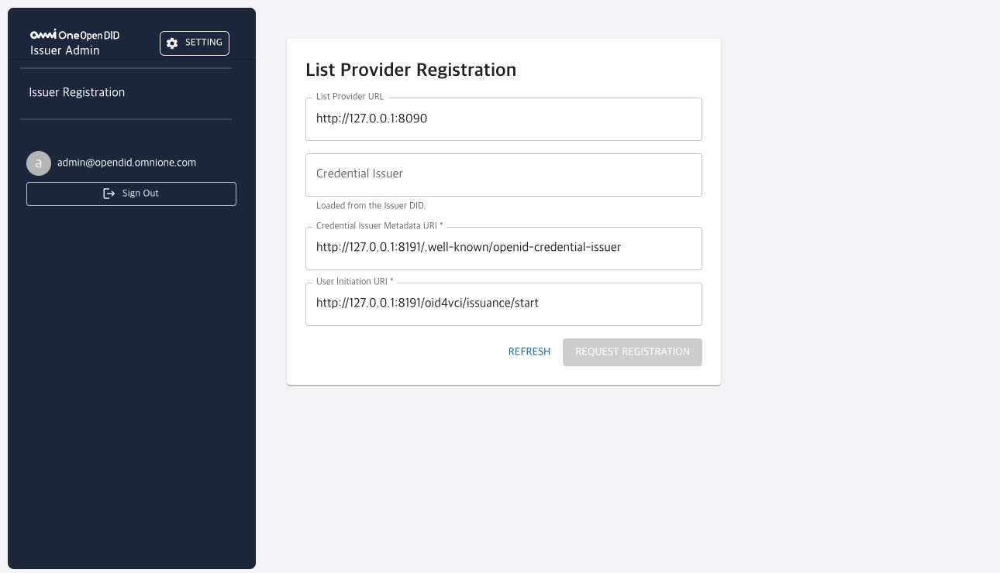

- 등록 전 초기 화면입니다. 기본 TA 주소 8090은 캡처용 TA 주소로 바꾸어야 합니다.

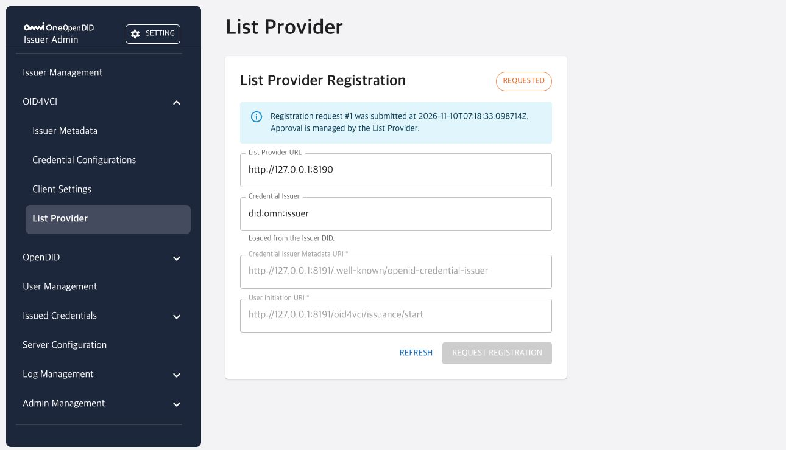

- TA 승인 뒤에도 Issuer 화면은 REQUESTED를 표시합니다. 실제 승인 상태는 TA 상세에서 확인했습니다.

### 6.3. Verifier Admin — OID4VP 검증

Verifier 엔티티 등록 후 Configuration → DCQL Scope Management → Policy Management 순서로 설정합니다. 기존 OpenDID VP 정책은 [Verifier Admin 가이드](https://github.com/OmniOneID/did-verifier-server/blob/feature/opendid3.0/docs/admin/OpenDID_VerifierAdmin_Operation_Guide_ko.md)를 따릅니다.

#### 6.3.1. Configuration

Wallet에 전달할 Verifier 정보, 세션 유효 시간, 암호화 옵션을 설정합니다. 이 설정은 Verifier 서버에 하나만 있으며 모든 OID4VP 요청에 적용됩니다. 캡처 환경에서는 Base URL을 `http://127.0.0.1:8192`로 저장했습니다.

| 화면 항목 | 설명 |
| --- | --- |
| Base URL / Client Name | Wallet이 접속할 Verifier 기준 주소와 사용자에게 표시할 이름입니다. |
| Client ID Scheme / Value | Verifier 식별 방식과 DID 또는 Redirect URI 값입니다. |
| Session TTL / Invocation Scheme | 검증 세션 유효 시간과 Wallet 호출 URI 스킴입니다. |
| Response Mode / JWE | `direct_post.jwt` 응답과 암호화 알고리즘입니다. |
| Enforce Claim Constraints / JSON Preview | DCQL Claim 조건 강제 여부와 저장될 설정 미리보기입니다. |

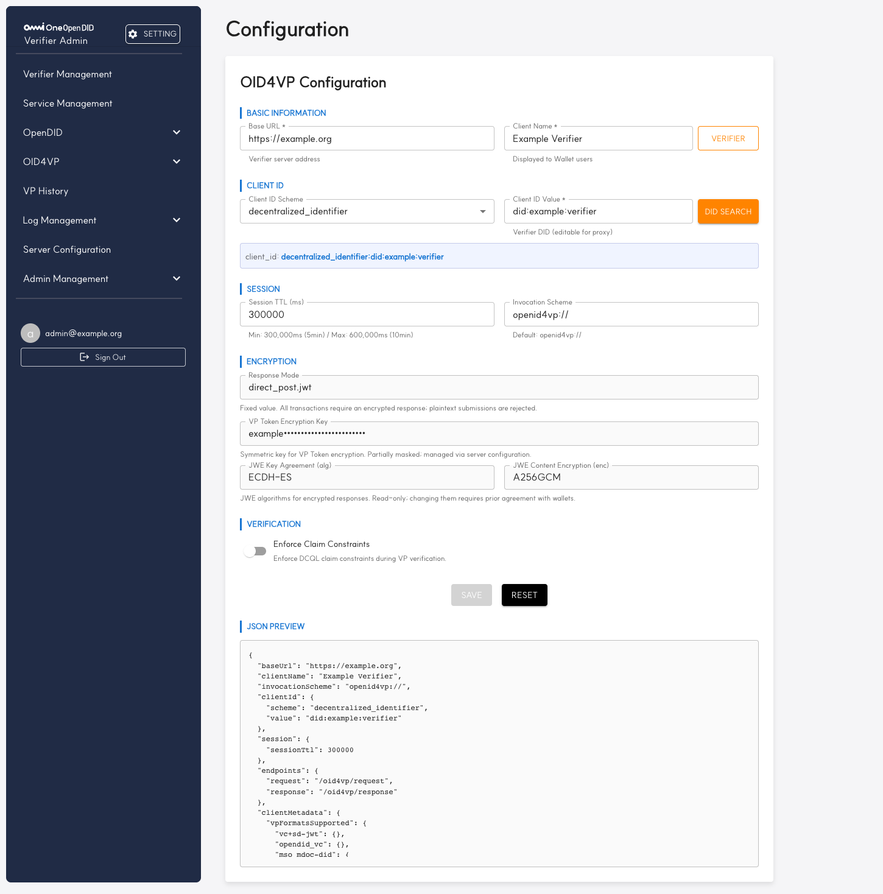

- OID4VP 설정 예시입니다. Verifier 주소, Client ID, 응답 암호화 값을 확인합니다.

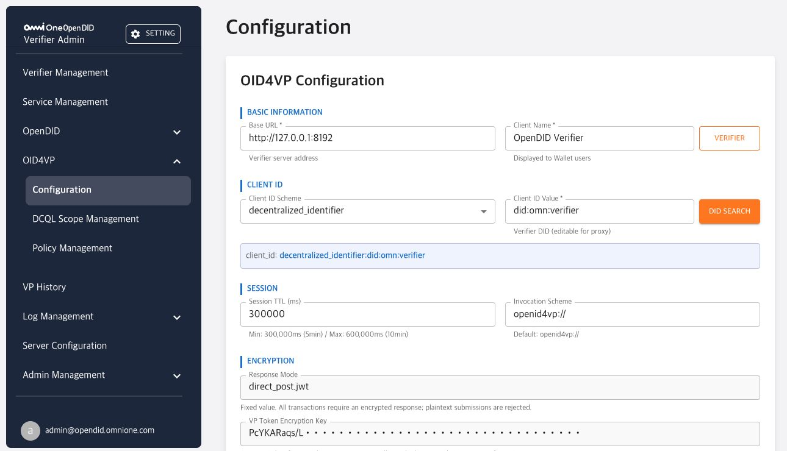

- 실제 Configuration 상단입니다. Base URL 8192와 Verifier DID를 확인합니다.

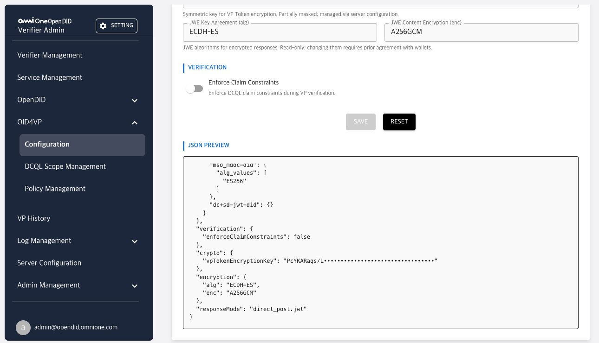

- 같은 화면의 하단입니다. direct_post.jwt와 JWE 설정, JSON Preview를 확인합니다.

#### 6.3.2. DCQL Scope Management

Scope는 Wallet에 요청할 Credential과 Claim을 DCQL Query로 묶습니다. Policy는 이 Scope를 참조합니다. 캡처 예시는 `capture_pid_mdoc` Scope에서 `org.omnione.opendid.doc` mdoc의 `given_name` Claim을 요청합니다.

| 화면 항목 | 설명 |
| --- | --- |
| Scope / Description / Enabled | 요청 식별자, 용도 설명, 사용 여부입니다. |
| Credential ID / Format | DCQL 안에서 Credential을 구분하는 ID와 요청 형식입니다. |
| Meta `doctype_value` | mdoc에서 요구할 문서 유형입니다. |
| Claims / DCQL Query JSON Preview | 요청할 Namespace·Claim과 생성된 Query를 확인합니다. |

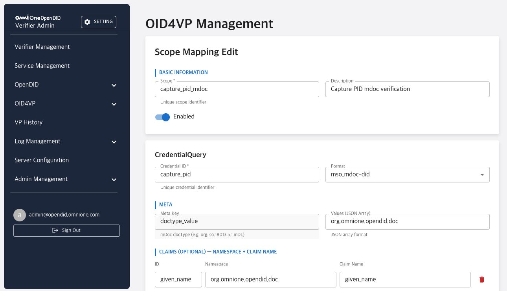

- 저장된 mdoc Scope의 식별자, 형식, doctype을 확인합니다.

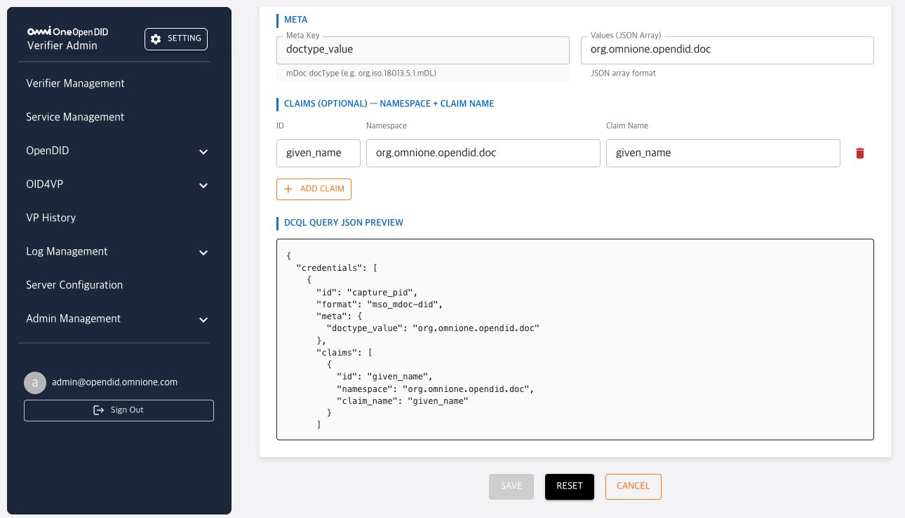

- Claim Namespace와 DCQL Query에 `org.omnione.opendid.doc`이 반영된 화면입니다.

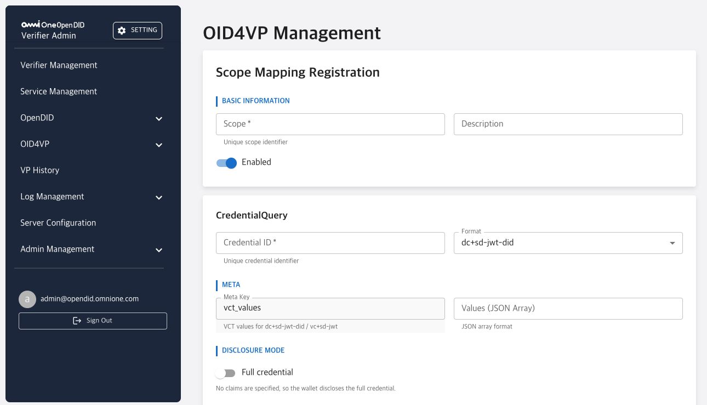

- 등록 전 DCQL Scope 폼 상단입니다. Scope와 Credential ID를 입력합니다.

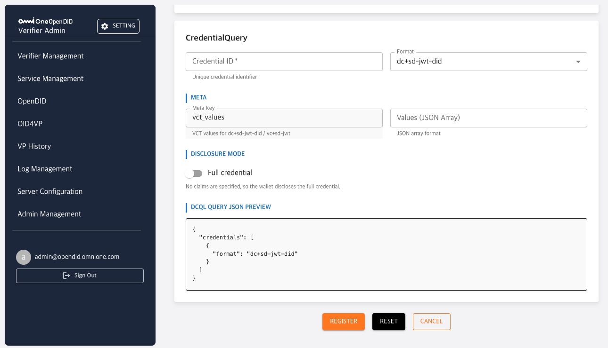

- 같은 폼의 하단입니다. 형식별 Metadata와 JSON Preview를 확인합니다.

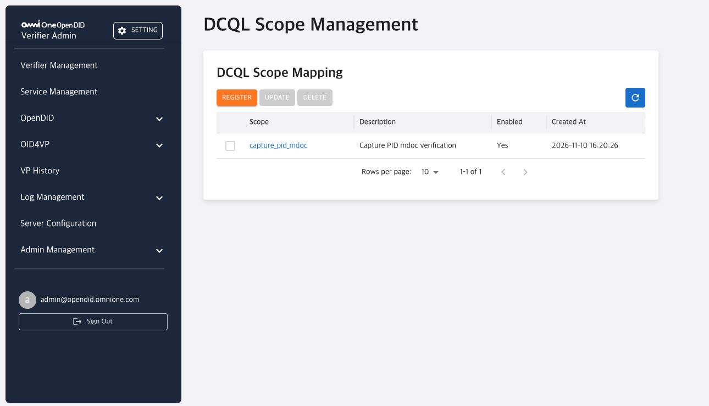

- 저장된 Scope 목록입니다. capture_pid_mdoc가 활성 상태로 표시됩니다.

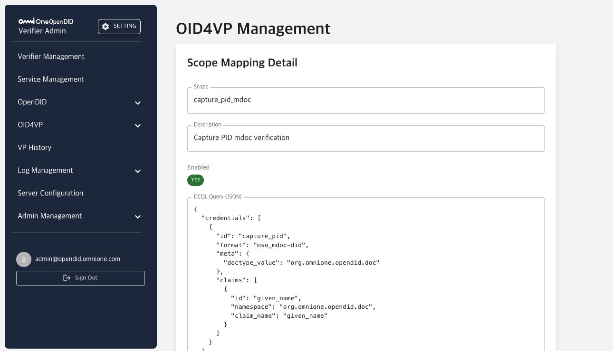

- 저장된 Scope 상세 상단입니다. Scope 이름과 DCQL Query의 앞부분을 확인합니다.

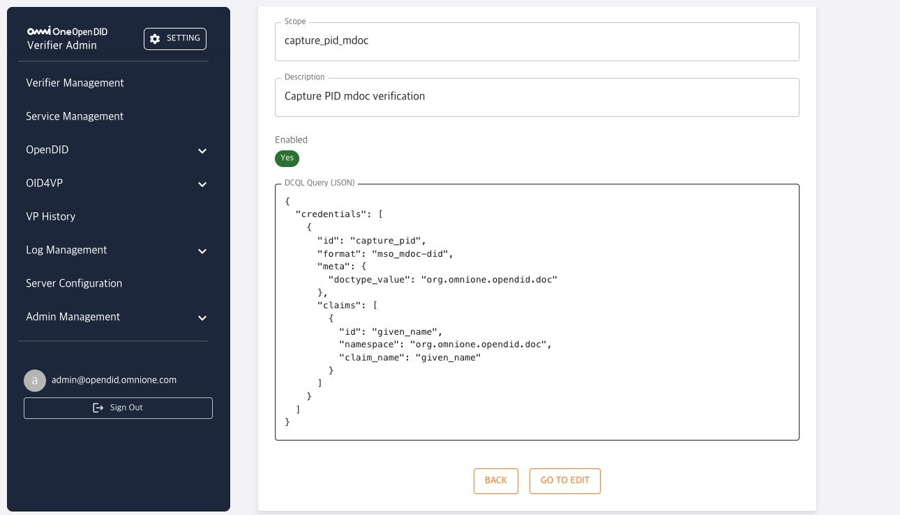

- 같은 상세의 하단입니다. `org.omnione.opendid.doc`과 given_name Claim을 포함한 Query를 확인합니다.

#### 6.3.3. Policy Management

OID4VP Policy는 앞서 등록한 DCQL Scope 하나와 연결됩니다. 검증 요청을 시작할 때 Policy를 지정하면 연결된 Scope의 DCQL Query가 Wallet 요청에 사용됩니다. 캡처 환경에서는 `Capture PID mdoc policy`를 `capture_pid_mdoc`에 연결했습니다.

| 화면 항목 | 설명 |
| --- | --- |
| Policy Title | 검증 정책을 구분하는 제목입니다. |
| Scope | Policy가 사용할 DCQL Scope입니다. 등록 시 활성 Scope를 검색해 선택합니다. |
| Policy ID | 저장할 때 자동 부여되는 식별자입니다. |

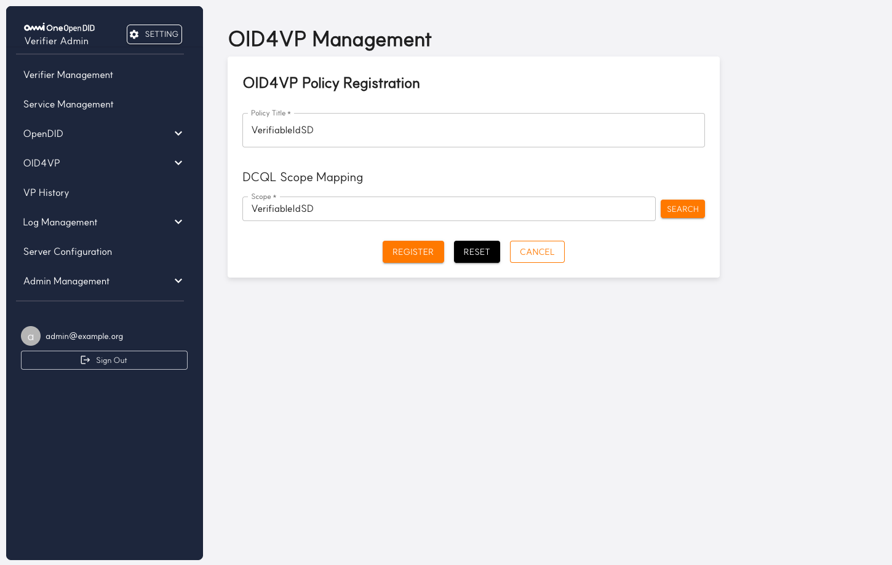

- OID4VP Policy 등록 예시입니다. 앞서 만든 DCQL Scope를 Policy에 연결합니다.

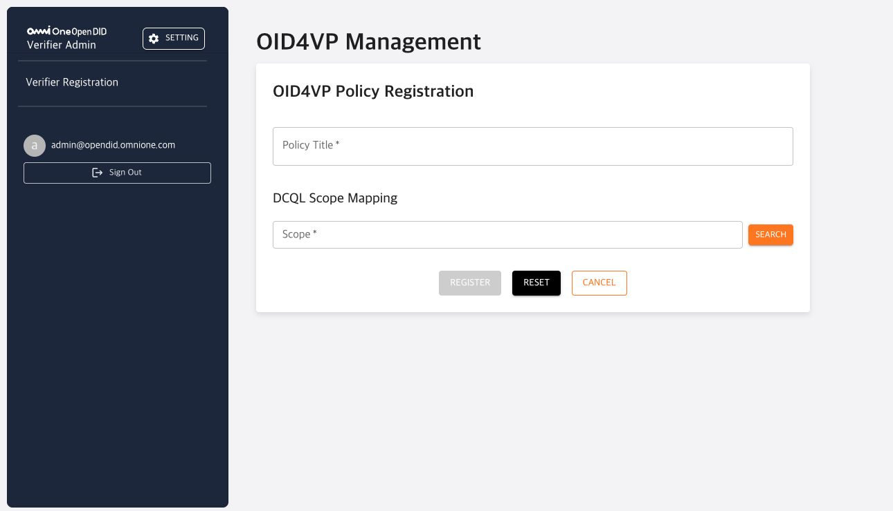

- 등록 전 Policy 폼입니다. 제목을 입력하고 DCQL Scope를 선택합니다.

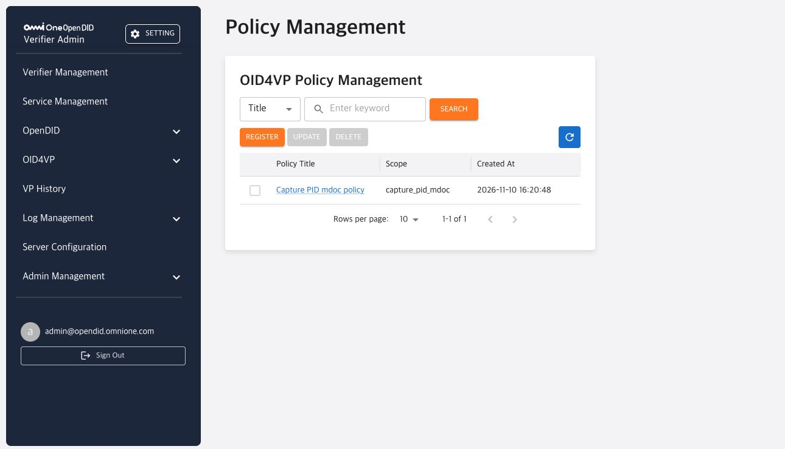

- 저장된 Policy 목록입니다. Capture PID mdoc policy가 capture_pid_mdoc에 연결됐습니다.

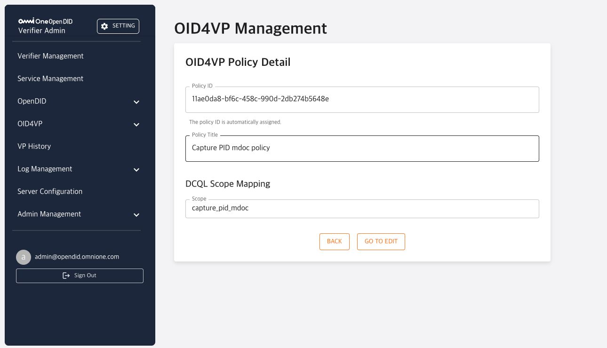

- Policy 상세입니다. 제목과 연결된 DCQL Scope를 확인합니다.

Demo의 서버 URL과 테스트 데이터는 [Demo 가이드](https://github.com/OmniOneID/did-demo-server/blob/feature/opendid3.0/docs/installation/OpenDID_DemoServer_InstallationAndOperation_Guide_ko.md)를 따릅니다. 실제 Credential 발급·Presentation 제출 결과는 [QA 계획서](./QA-PLAN-V3.0.0.0.md)에 별도로 기록합니다.

## 7. OpenDID 테스트 가이드

1. 선택한 서비스의 상태를 확인하고 Proxy에 지갑·DID 생성 버튼이 없는지 확인합니다.
2. Holder 등록 후 **Holder 앱 → Proxy → Issuer** 경로로 OpenDID VC를 발급합니다. 제안·프로파일·발급·완료 응답을 확인하고 이 발급 경로에서 TA가 중계하지 않는지 확인합니다.
3. Issuer의 OID4VCI 경로를 별도로 테스트합니다. Issuer Metadata와 Credential Offer를 조회하고, Pre-Authorized Code 또는 Authorization Code 흐름, Holder Proof, Credential 수령을 확인합니다. 호환 지갑과 [Demo 가이드](https://github.com/OmniOneID/did-demo-server/blob/feature/opendid3.0/docs/installation/OpenDID_DemoServer_InstallationAndOperation_Guide_ko.md)를 사용합니다.
4. Status List와 설정된 경우 OpenDID Holder 서명 기반 폐기 확장을 확인합니다. 잘못되거나 재사용한 Nonce·Proof 요청은 거절돼야 합니다.
5. Verifier에 OpenDID VP와 OID4VP Presentation을 각각 제출하고 SD-JWT VC·mdoc 지원 경로를 확인합니다.

결과는 [QA 계획서](./QA-PLAN-V3.0.0.0.md)에 기록합니다. Android·iOS 앱 설명은 별도로 갱신합니다.

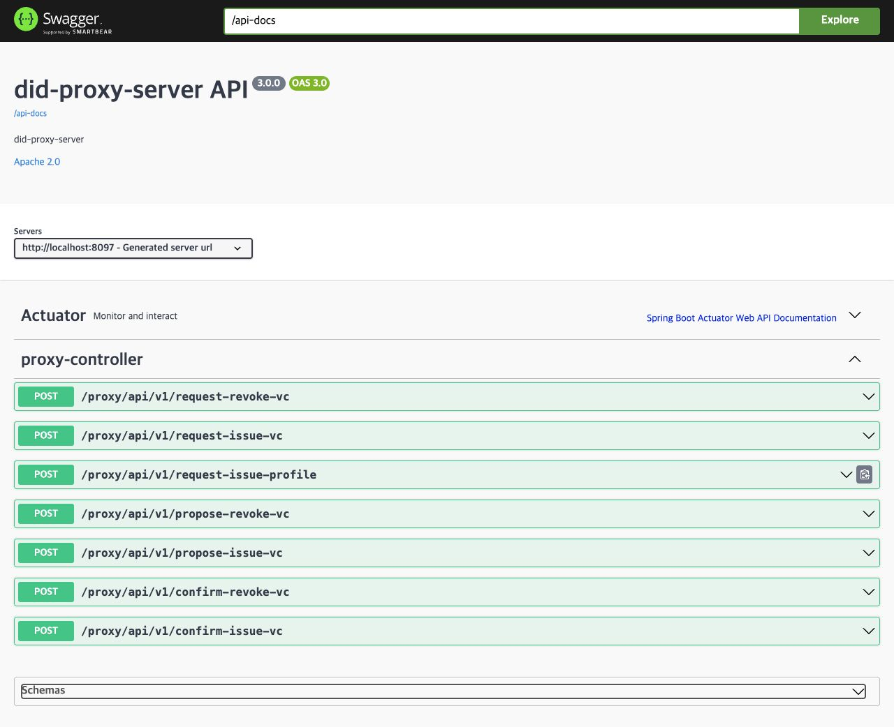
