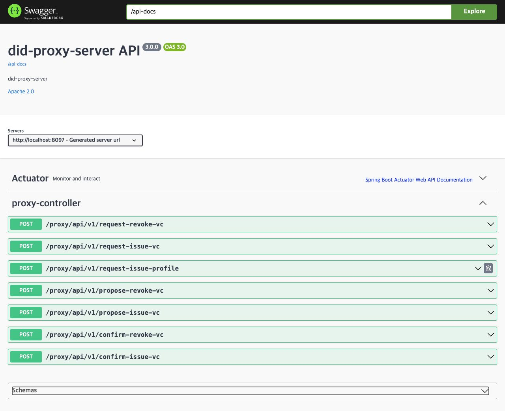

# OpenDID Installation Guide — Manual — v3.0.0.0

## 1. OpenDID Introduction

This guide describes manual installation of OpenDID 3.0 servers. The integrated release version is 3.0.0.0 and individual server build versions are 3.0.0. Proxy relays the OpenDID Holder app–Issuer issuance path; it is not an entity and does not own a wallet or DID. OID4VCI issuance is provided by Issuer as a separate protocol path.

## 2. Installation Overview

Install the database and selected ledger backend, then TA and API Gateway. Configure and start Issuer, Verifier, CA, Wallet, Proxy, and Demo. Register only entities that require registration. Complete administrator setup before end-to-end issuance and presentation tests.

## 3. System Requirements

See [System Requirements](./OpenDID_System_Requirements.md). The default Orchestrator port map can be used as a local reference even when starting services manually: TA 8090, Issuer 8091, Verifier 8092, API 8093, CA 8094, Wallet 8095, Proxy 8097, Ledger Service 8098, and Demo 8099. Check every server's own configuration because ports and backend URLs may be overridden.

## 4. Prerequisites

Install Java 21, Git, Docker, and PostgreSQL tooling needed by your deployment. Use each repository's Gradle wrapper. Check out `feature/opendid3.0` for participating server repositories where available; Proxy currently uses its `develop` branch. At this stage, build 3.0.0 JARs from source because the matching GitHub Release assets are not yet confirmed.

### 4.1. Source and version

Use the 3.0 development branches listed in the [documentation hub](./OpenDID_Documentation_Hub.md). The participating servers currently use `feature/opendid3.0`; Proxy uses `develop`. Check `version = '3.0.0'` in each `build.gradle`. Build from source until matching 3.0 release artifacts are published and verified.

```bash
git clone --branch feature/opendid3.0 https://github.com/OmniOneID/did-ta-server.git
git clone --branch develop https://github.com/OmniOneID/did-proxy-server.git
```

For existing clones, check local changes before updating the selected branch to its latest commit.

### 4.2. Database, ledger, and configuration

Create a database and account for each database-backed server. Set its connection in `src/main/resources/config/application-database*.yml`; TA uses `application-databases*.yml`. Follow the server-specific guide for database names and migrations.

Choose either the Besu network and contracts in the [Besu Contract guide](https://github.com/OmniOneID/did-besu-contract/blob/main/README.md), or [Ledger Service](https://github.com/OmniOneID/did-ledger-service-server/blob/feature/opendid3.0/docs/installation/OpenDID_LedgerService_InstallationAndOperation_Guide.md). When using LSS, set `lss.url` in supported servers' `application-lss.yml` and use the `dev,lss` profiles. The `sample` profile is for sample configuration; select a profile with actual database and ledger integration for system tests.

Set the port, TA URL, ledger URL, peer service URLs, and wallet paths in each server's `application.yml` and related configuration. Inside a container, `localhost` refers to that container. The Proxy source currently has a private IP in `issuer.url`; change it to the reachable Issuer URL before starting Proxy.

## 5. Installation and Registration

### 5.1. Build and run each server

Run the following commands in each repository's `source/<Gradle project>` directory. Do not skip the frontend build where the admin UI is needed. Confirm that the executable JAR is version 3.0.0; if a `*-plain.jar` is also produced, select the executable JAR.

```bash
cd <repository>/source/<Gradle-project>
./gradlew clean build
ls build/libs/*3.0.0*.jar
java -jar build/libs/<server-name>-3.0.0.jar --spring.profiles.active=dev
```

Replace the placeholders with the project below and the JAR actually produced. For a server that supports LSS, check its installation guide and use `--spring.profiles.active=dev,lss`. Start each server in a separate terminal or service manager. Check its startup log for database and ledger connectivity and, where exposed, `http://127.0.0.1:<port>/actuator/health` before proceeding.

| Repository | Gradle project | Detailed installation guide |
| --- | --- | --- |
| `did-ledger-service-server` | `source/did-ledger-service-server` | [Ledger Service](https://github.com/OmniOneID/did-ledger-service-server/blob/feature/opendid3.0/docs/installation/OpenDID_LedgerService_InstallationAndOperation_Guide.md) |
| `did-ta-server` | `source/did-ta-server` | [TA](https://github.com/OmniOneID/did-ta-server/blob/feature/opendid3.0/docs/installation/OpenDID_TAServer_Installation_Guide.md) |
| `did-api-server` | `source/did-api-server` | [API Gateway](https://github.com/OmniOneID/did-api-server/blob/feature/opendid3.0/docs/installation/OpenDID_APIGatewayServer_InstallationAndOperation_Guide.md) |
| `did-issuer-server` | `source/did-issuer-server` | [Issuer](https://github.com/OmniOneID/did-issuer-server/blob/feature/opendid3.0/docs/installation/OpenDID_IssuerServer_Installation_Guide.md) |
| `did-verifier-server` | `source/did-verifier-server` | [Verifier](https://github.com/OmniOneID/did-verifier-server/blob/feature/opendid3.0/docs/installation/OpenDID_VerifierServer_Installation_Guide.md) |
| `did-ca-server` | `source/did-ca-server` | [CA](https://github.com/OmniOneID/did-ca-server/blob/feature/opendid3.0/docs/installation/OpenDID_CAServer_Installation_Guide.md) |
| `did-wallet-server` | `source/did-wallet-server` | [Wallet](https://github.com/OmniOneID/did-wallet-server/blob/feature/opendid3.0/docs/installation/OpenDID_WalletServer_Installation_Guide.md) |
| `did-proxy-server` | `source/did-proxy-server` | [Proxy API](https://github.com/OmniOneID/did-proxy-server/blob/develop/docs/api/Proxy_API.md) |
| `did-demo-server` | `source/did-demo-server` | [Demo](https://github.com/OmniOneID/did-demo-server/blob/feature/opendid3.0/docs/installation/OpenDID_DemoServer_InstallationAndOperation_Guide.md) |

### 5.2. Entity registration sequence

1. In the TA Admin Console, complete the server password, basic information, DID creation, ledger registration, and membership certificate issuance. TA must be registered before it can approve other entities.
2. Verify API Gateway connectivity to the selected ledger backend. API Gateway does not need TA entity registration.
3. In order, start Issuer, Verifier, CA, and Wallet. Create a DID Document and request registration in each admin UI. Approve and register it on the ledger in TA Admin, then finish membership certificate issuance in that server's admin UI.
4. Check Proxy's `issuer.url` and start it. Proxy has no wallet, DID, or TA registration step.
5. Configure Demo with the running service URLs and test data. Demo is not a TA entity.

For field-level registration instructions, see the [server admin guides](./OpenDID_Documentation_Hub.md#server-documentation) and [admin screen captures](./OpenDID_Installation_Guide-Orchestrator-V3.0.0.0.md#6-admin-configuration). Install Android and iOS clients separately.

| Order | Component | Action |
| --- | --- | --- |
| 1 | PostgreSQL and Besu or Ledger Service | Start the database and selected ledger backend; set URLs and credentials in each server config. |
| 2 | TA | Build, start, and register TA; complete initial admin settings. |
| 3 | API Gateway | Build, start, and point it at the ledger backend. |
| 4 | Issuer | Build, start, register the Issuer entity, then configure issuance profiles and OID4VCI Metadata. |
| 5 | Verifier | Build, start, register the Verifier entity, then configure OpenDID and OID4VP policies. |
| 6 | CA and Wallet | Build, start, and complete their required entity registration and settings. |
| 7 | Proxy | Build and start; configure connectivity to Issuer. No Proxy wallet, DID, or TA entity registration. |
| 8 | Demo | Build, start, and configure the service URLs for integration tests. |

For each component, follow the exact build command, runtime profile, database migration, and configuration steps in its [server-specific installation guide](./OpenDID_Documentation_Hub.md). Use the produced 3.0.0 JAR and verify its health endpoint before moving to the next component. Do not use a 2.0.0 JAR under a renamed 3.0.0 filename.

The Proxy API surface can be checked at its Swagger page after startup:



## 6. Admin Configuration

Configure TA → Issuer → Verifier in that order. The [Orchestrator guide, section 6](./OpenDID_Installation_Guide-Orchestrator-V3.0.0.0.md#6-admin-configuration) documents the same admin menus and screenshots used in manual deployments: TA trust lists, Issuer OID4VCI Metadata/credential/client/List Provider settings, and Verifier OID4VP Configuration/DCQL Scope/Policy. Complete first admin login and entity registration before accessing these menus.

In Demo, enter the running server URLs and prepare issuance/presentation test data. Refer to the [documentation hub](./OpenDID_Documentation_Hub.md) for API and admin details. Android and iOS client instructions will be updated separately.

## 7. OpenDID Test Guide

1. Complete Holder registration and verify the server health and ledger mode.
2. Issue an OpenDID VC through Holder app → Proxy → Issuer. Verify offer/profile, issuance, and completion responses; check that Proxy has no entity wallet/DID.
3. Test OID4VCI separately using Issuer Metadata and a compatible wallet: Credential Offer, Pre-Authorized Code or Authorization Code, Token, proof, Credential, and Status List. Where enabled, test the Holder-signed revocation extension and nonce reuse rejection.
4. Submit an OpenDID VP and an OID4VP presentation to Verifier; verify supported credential formats and status checks.

Record results against the [QA plan](./QA-PLAN-V3.0.0.0.md).
