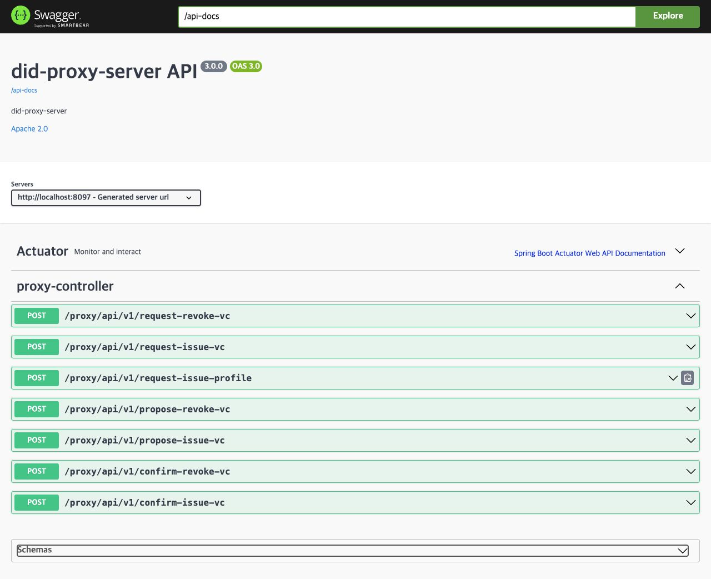

# OpenDID 설치 가이드 — 수동 설치 — v3.0.0.0

## 1. OpenDID 소개

이 문서는 OpenDID 3.0 서버를 개별적으로 설치하는 방법을 설명합니다. 통합 릴리스 버전은 3.0.0.0, 개별 서버 빌드 버전은 3.0.0입니다. Proxy는 Holder 앱과 Issuer 사이의 OpenDID 발급 경로를 중계하며, 엔티티나 지갑·DID 보유 서버가 아닙니다. OID4VCI 발급은 Issuer가 제공하는 별도 프로토콜 경로입니다.

## 2. 설치 개요

DB와 선택한 원장 백엔드를 준비한 뒤 TA와 API Gateway를 설치합니다. 이어 Issuer, Verifier, CA, Wallet, Proxy, Demo를 설정·실행합니다. 등록이 필요한 엔티티만 등록하고 관리자 설정을 마친 뒤 발급·제출 통합 테스트를 수행합니다.

## 3. 시스템 요구사항

[시스템 요구사항](./OpenDID_System_Requirements_ko.md)을 확인하세요. 수동 실행 시에도 Orchestrator 기본 포트 맵을 참고할 수 있습니다: TA 8090, Issuer 8091, Verifier 8092, API 8093, CA 8094, Wallet 8095, Proxy 8097, Ledger Service 8098, Demo 8099. 포트와 백엔드 URL은 각 서버 설정에서 달라질 수 있습니다.

## 4. 사전 준비

Java 21, Git, Docker와 배포 방식에 필요한 PostgreSQL 도구를 설치합니다. 각 저장소의 Gradle wrapper를 사용합니다. 해당 서버에 `feature/opendid3.0` 브랜치가 있으면 이를 체크아웃하고, Proxy는 현재 `develop` 브랜치를 사용합니다. 대응하는 GitHub Release 아티팩트가 아직 확인되지 않았으므로 현재 3.0 통합 테스트에서는 소스에서 3.0.0 JAR를 빌드합니다.

### 4.1. 소스와 버전 확인

[문서 허브](./OpenDID_Documentation_Hub_ko.md)의 저장소별 3.0 개발 브랜치를 사용합니다. 현재 Proxy는 `develop`, 나머지 참여 서버는 `feature/opendid3.0` 브랜치를 사용합니다. 각 `build.gradle`의 `version = '3.0.0'`을 확인하세요. 게시된 3.0 릴리스 아티팩트가 확인되기 전에는 소스에서 직접 빌드합니다.

```bash
git clone --branch feature/opendid3.0 https://github.com/OmniOneID/did-ta-server.git
git clone --branch develop https://github.com/OmniOneID/did-proxy-server.git
```

이미 clone한 소스는 로컬 변경을 확인한 뒤 해당 브랜치를 최신 커밋으로 갱신합니다.

### 4.2. 데이터베이스·원장·설정

DB를 사용하는 서버마다 별도 데이터베이스와 계정을 준비하고, 서버의 `src/main/resources/config/application-database*.yml`에 연결 정보를 입력합니다. TA는 `application-databases*.yml`을 사용합니다. 마이그레이션과 DB 이름은 서버별 설치 문서를 따릅니다.

원장은 [Besu Contract](https://github.com/OmniOneID/did-besu-contract/blob/main/README_ko.md)의 Besu 네트워크·컨트랙트 또는 [Ledger Service](https://github.com/OmniOneID/did-ledger-service-server/blob/feature/opendid3.0/docs/installation/OpenDID_LedgerService_InstallationAndOperation_Guide_ko.md) 중 하나를 준비합니다. LSS 사용 시 지원 서버의 `application-lss.yml`에서 `lss.url`을 맞추고 `dev,lss` 프로파일로 실행합니다. `sample`은 예제용 프로파일이므로 실제 DB·원장 통합에는 알맞은 프로파일을 명시하세요.

각 서버의 `application.yml` 및 관련 설정에서 포트, TA URL, 원장 URL, 다른 서버 URL, 지갑 경로를 실제 환경에 맞춥니다. 컨테이너에서 `localhost`는 컨테이너 자신을 가리킵니다. 특히 Proxy의 기본 `issuer.url`은 소스에 특정 사설 IP로 지정되어 있으므로 실행 중인 Issuer 주소로 반드시 변경하세요.

## 5. 설치 및 등록

### 5.1. 공통 빌드·실행 방법

각 저장소의 `source/<Gradle 프로젝트>`에서 아래 명령을 실행합니다. 관리자 화면이 필요한 서버에서는 프런트엔드 빌드를 생략하지 마세요. 생성된 실행 JAR가 3.0.0인지 확인하고, `*-plain.jar`가 함께 있으면 실행 JAR를 선택합니다.

```bash
cd <저장소>/source/<Gradle-프로젝트>
./gradlew clean build
ls build/libs/*3.0.0*.jar
java -jar build/libs/<서버명>-3.0.0.jar --spring.profiles.active=dev
```

`<...>`는 아래 표와 실제 생성된 JAR 이름으로 바꿉니다. LSS 연동이 지원되는 서버는 서버별 설치 문서를 확인하여 `--spring.profiles.active=dev,lss`를 사용합니다. 각 서버를 별도 터미널 또는 서비스 매니저로 실행하고, 시작 로그의 DB·원장 연결과 `http://127.0.0.1:<포트>/actuator/health` 응답을 확인한 다음 다음 단계로 진행합니다.

| 서버 저장소 | Gradle 프로젝트 | 상세 설치 문서 |
| --- | --- | --- |
| `did-ledger-service-server` | `source/did-ledger-service-server` | [Ledger Service](https://github.com/OmniOneID/did-ledger-service-server/blob/feature/opendid3.0/docs/installation/OpenDID_LedgerService_InstallationAndOperation_Guide_ko.md) |
| `did-ta-server` | `source/did-ta-server` | [TA](https://github.com/OmniOneID/did-ta-server/blob/feature/opendid3.0/docs/installation/OpenDID_TAServer_Installation_Guide_ko.md) |
| `did-api-server` | `source/did-api-server` | [API Gateway](https://github.com/OmniOneID/did-api-server/blob/feature/opendid3.0/docs/installation/OpenDID_APIGatewayServer_InstallationAndOperation_Guide_ko.md) |
| `did-issuer-server` | `source/did-issuer-server` | [Issuer](https://github.com/OmniOneID/did-issuer-server/blob/feature/opendid3.0/docs/installation/OpenDID_IssuerServer_Installation_Guide_ko.md) |
| `did-verifier-server` | `source/did-verifier-server` | [Verifier](https://github.com/OmniOneID/did-verifier-server/blob/feature/opendid3.0/docs/installation/OpenDID_VerifierServer_Installation_Guide_ko.md) |
| `did-ca-server` | `source/did-ca-server` | [CA](https://github.com/OmniOneID/did-ca-server/blob/feature/opendid3.0/docs/installation/OpenDID_CAServer_Installation_Guide_ko.md) |
| `did-wallet-server` | `source/did-wallet-server` | [Wallet](https://github.com/OmniOneID/did-wallet-server/blob/feature/opendid3.0/docs/installation/OpenDID_WalletServer_Installation_Guide_ko.md) |
| `did-proxy-server` | `source/did-proxy-server` | [Proxy API](https://github.com/OmniOneID/did-proxy-server/blob/develop/docs/api/Proxy_API_ko.md) |
| `did-demo-server` | `source/did-demo-server` | [Demo](https://github.com/OmniOneID/did-demo-server/blob/feature/opendid3.0/docs/installation/OpenDID_DemoServer_InstallationAndOperation_Guide_ko.md) |

### 5.2. 엔티티 등록 순서

1. TA Admin Console에서 서버 비밀번호, 기본 정보, DID 생성, 원장 등록, 가입 증명서 발급을 완료합니다. TA를 먼저 등록해야 다른 엔티티의 요청을 승인할 수 있습니다.
2. API Gateway는 선택한 원장 백엔드 연결을 확인합니다. TA 엔티티 등록 대상은 아닙니다.
3. Issuer → Verifier → CA → Wallet 관리자 화면에서 각각 DID Document를 생성하고 TA 등록을 요청합니다. TA 관리자에서 요청을 승인하고 원장에 등록한 다음, 해당 서버 관리자 화면에서 가입 증명서 발급을 마칩니다.
4. Proxy의 `issuer.url`을 확인한 뒤 실행합니다. Proxy에는 지갑·DID·TA 등록 단계가 없습니다.
5. Demo에 실행 중인 서버 URL과 테스트 데이터를 입력합니다. Demo도 TA 등록 대상이 아닙니다.

등록 화면별 입력값과 상세 동작은 [서버별 관리 문서](./OpenDID_Documentation_Hub_ko.md#서버-문서) 및 [관리 화면 캡처](./OpenDID_Installation_Guide-Orchestrator-V3.0.0.0_ko.md#6-어드민-설정)를 따릅니다. Android·iOS 클라이언트 설치는 각각 별도로 진행합니다.

| 순서 | 구성 요소 | 작업 |
| --- | --- | --- |
| 1 | PostgreSQL 및 Besu 또는 Ledger Service | DB와 선택한 원장 백엔드를 시작하고 서버별 URL·인증 정보를 설정합니다. |
| 2 | TA | 빌드·시작·등록한 뒤 초기 관리자 설정을 완료합니다. |
| 3 | API Gateway | 빌드·시작하고 원장 백엔드 연결을 설정합니다. |
| 4 | Issuer | 빌드·시작·엔티티 등록 후 발급 프로파일과 OID4VCI Metadata를 설정합니다. |
| 5 | Verifier | 빌드·시작·엔티티 등록 후 OpenDID·OID4VP 정책을 설정합니다. |
| 6 | CA 및 Wallet | 빌드·시작하고 필요한 엔티티 등록과 설정을 완료합니다. |
| 7 | Proxy | 빌드·시작하고 Issuer 연결을 설정합니다. Proxy 지갑·DID·TA 엔티티 등록 단계는 없습니다. |
| 8 | Demo | 빌드·시작하고 통합 테스트용 서버 URL을 설정합니다. |

각 서버의 정확한 빌드 명령, 실행 Profile, DB 마이그레이션 및 설정 방법은 [서버별 설치 가이드](./OpenDID_Documentation_Hub_ko.md)를 따릅니다. 생성된 3.0.0 JAR의 상태를 확인한 뒤 다음 단계로 진행하세요. 2.0.0 JAR의 파일명만 3.0.0으로 바꿔 사용하면 안 됩니다.

Proxy 실행 후 Swagger 화면에서 API 목록을 확인할 수 있습니다.



## 6. 어드민 설정

TA → Issuer → Verifier 순서로 설정합니다. TA의 OID4VCI 발급자 신뢰 목록, Issuer의 Metadata·Credential Configuration·Client·List Provider, Verifier의 OID4VP Configuration·DCQL Scope·Policy 설정은 [Orchestrator 설치 가이드의 6장](./OpenDID_Installation_Guide-Orchestrator-V3.0.0.0_ko.md#6-어드민-설정)에 화면과 단계별 설명을 모았습니다. 수동 설치에서도 같은 관리자 메뉴를 사용합니다.

Demo에는 실행 중인 서버 URL과 발급·제출 테스트 데이터를 입력합니다. API·관리 문서는 [문서 허브](./OpenDID_Documentation_Hub_ko.md)를 참고하세요. Android·iOS 클라이언트 설명은 별도로 갱신합니다.

## 7. OpenDID 테스트 가이드

1. Holder 등록을 완료하고 서버 상태와 원장 모드를 확인합니다.
2. Holder 앱 → Proxy → Issuer 경로로 OpenDID VC를 발급합니다. 제안·프로파일·발급·완료 응답과 Proxy의 비엔티티 역할을 확인합니다.
3. OID4VCI는 Issuer Metadata와 호환 지갑을 사용해 별도로 테스트합니다. Credential Offer, Pre-Authorized Code 또는 Authorization Code, Token, Proof, Credential, Status List를 확인합니다. 활성화된 경우 Holder 서명 기반 폐기 확장과 Nonce 재사용 거절도 확인합니다.
4. Verifier에 OpenDID VP와 OID4VP Presentation을 제출하고 Credential 형식과 상태 검사를 확인합니다.

결과는 [QA 계획서](./QA-PLAN-V3.0.0.0.md)에 기록합니다.
